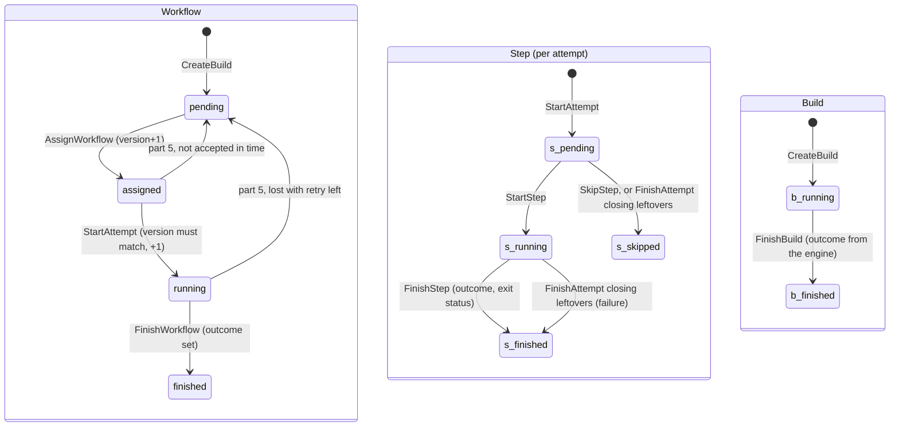
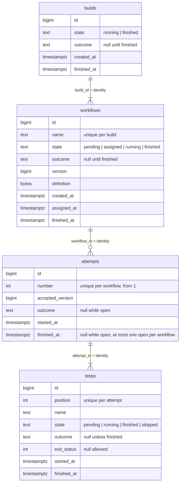

## Goal Capsule

- **Objective:** `internal/model` types every state and outcome of the build lifecycle, the snapshot of a build, and the store's conflict and not-found errors.
- **Parent:** #20, part 1 of 5. Read it only for a question this part does not answer.
- **Open blockers:** none.

## Product Contract

### Summary

This part adds the lifecycle's types to `internal/model`: build, workflow and step states, outcomes, the snapshot types `GetBuild` will return, and the conflict and not-found sentinels.
They do no I/O, and the store of parts 3 to 5 of this split returns them.

### Context

Every later part of this split, and the engine after it, speaks in these types, so the states are decided once, here.
U1 builds some of R11, which part 5 of this split completes. R11: "A workflow moves `pending → assigned → running → finished`, and has an outcome (success or failure) only once finished. A step moves `pending → running → finished`, or ends `skipped`. A build moves `running → finished` with its workflow's outcome."
Text copied from #20 says "part 1" to "part 7" for the parts of #4, of which #20 is part 2. This split's parts are "part k of this split" here and "Part k" under Builds on.

### Key Decisions

- **A workflow's state is separate from its outcome, and there are few states.** A state exists only where the engine treats the workflow differently. Why it waits (a runner, later a slot) is an attribute of the `crew.wait` span, not a state. Slice 2 adds `waiting` for dependencies. Governs R11. (session-settled: user-approved — chosen over one state per wait reason and over one status that mixes state and outcome.)

### Scope Boundaries

- This part adds types only. The URL parser is part 2 of this split, the schema part 3, and the store's primitives parts 4 and 5.
- The `waiting` state for dependencies stays with slice 2.
- `depguard` rules for the architecture's import rules, and the fix to `wrapcheck`'s glob that still names crew's module, belong to part 1 (#19). This part's imports already follow `docs/architecture.md` section 4.
- The architecture's decision-log entries for the base schema, the states and the host belong to part 7 (#25).

### Sources / Research

Split from #20.

- `docs/architecture.md`: section 4 (package layout and import rules), and D4.
- `docs/exploration/crew-actions.md`: "Next: a build's lifecycle".
- `.github/workflows/ci.yml` and `.testcoverage.yml`: `go test -race -coverpkg=./...` on Linux and macOS, and a 90% total coverage floor checked on Linux only.

---

## Planning Contract

### Key Technical Decisions

- KTD1. **One `postgres.Store` exposes small lifecycle primitives, and a transaction travels in the `context.Context`.** `Store.InTx(ctx, fn)` begins a transaction and passes `fn` a context that carries it. Every primitive joins the context's transaction when there is one, and otherwise runs in its own, so each primitive is atomic alone. No signature uses a pgx type. Primitives return `internal/model` types, and the conflict and not-found sentinels live in `internal/model`. So part 4's engine can declare its store interfaces with plain signatures, own the transactions (architecture section 4), and branch on errors without importing `store/postgres`. Rejected: an `InTx` callback that receives a store-specific `*Tx`, which would put a store type into every interface the engine declares.
- KTD2. **Four tables (`builds`, `workflows`, `attempts`, `steps`), with steps belonging to an attempt.** A new attempt starts from the first step, and each attempt's logs stay apart (parent R15, R21). So step rows per attempt keep attempt 1's history when attempt 2 runs. Ids are `bigint` identity columns, the plainest option, which needs no extra dependency.
- KTD4. **States and outcomes are `text` columns with CHECK constraints, not Postgres enums.** Every table that has an outcome checks `(state = 'finished') = (outcome IS NOT NULL)`. The outcome check allows `success` and `failure` only (D4). Slice 2's `waiting` then becomes one migration that replaces a constraint, while a new enum value cannot be used in the transaction that adds it. Governs R11.
- KTD7. **Transitions are strict compare-and-set updates.** Each primitive moves a row from one named state to the next (`UPDATE … WHERE state = <from>`). A row in any other state gives the model's conflict sentinel, and a missing row gives not-found. Repeats are conflicts too (see Scope Boundaries).

### High-Level Technical Design

**Lifecycles (R11, KTD4, KTD8).**

**Schema (KTD2, KTD3, KTD5, KTD6, KTD12).** Every table also has `host`, `organization` and `repository`, all non-empty. Each foreign key includes them.

### Sequencing

U1 is the only unit, and needs nothing.

---

## Implementation Units

### U1. Lifecycle types and the store's errors

**Goal:** `internal/model` types every state and outcome of R11, and holds the conflict and not-found sentinels the store returns.

**Requirements:** R11; KTD1, KTD4, KTD7.

**Dependencies:** none.

**Files:**
- Create `internal/model/model.go` (package doc naming the lifecycles), `internal/model/state.go`, `internal/model/errors.go`, `internal/model/state_test.go`.
- Create `internal/model/build.go` for the snapshot types `GetBuild` returns (build, workflow, attempt, step, with typed ids).
- Delete `internal/model/.gitkeep`.

**Approach:**
- One string-based type each for build state, workflow state, step state and outcome, each with constants and a parse function. The parse function turns a column value into the type and errors on anything else, so a value the schema allows but Go does not know fails loudly.
- An outcome is optional on the snapshot types until the row is finished (KTD4).
- The package imports nothing that does I/O (architecture section 4).

**Patterns to follow:** `cmd/crew-actions/main.go` (doc comment on every identifier, named constant groups) and `cmd/crew-actions/main_test.go` (stdlib table tests, got/want messages).

**Test scenarios:**
- Each state and outcome constant parses back to itself from its string.
- An unknown string (`"waiting"`, `""`, `"Success"`) is an error for every parse function.
- `errors.Is` matches each sentinel after it has been wrapped with context.

**Verification:** the package builds with no I/O import, and its tests pass.

---

## Verification Contract

| Gate | Command or check | Applies to |
|---|---|---|
| Format and vet | `gofmt -l cmd internal` prints nothing, and `go vet ./...` passes | all |
| Lint | golangci-lint v2.14.0 (`go run github.com/golangci/golangci-lint/v2/cmd/golangci-lint@v2.14.0 run`) passes with `.golangci.yml` as it is | all |
| Tests | `go test -race -covermode=atomic -coverpkg=./... -coverprofile=coverage.out ./...` passes with Docker running, and the store's tests skip cleanly without Docker | all |
| Coverage floor | the total in `coverage.out` is at least 90% (`.testcoverage.yml`) | all |

---

## Definition of Done

- Every gate in the Verification Contract passes, locally with Docker and in CI's Linux and macOS jobs.
- `internal/model` imports nothing that does I/O. pgx, goose and the generated queries are imported only under `internal/store/postgres`.
- No command, protocol call, lease column or telemetry code was added.

<!-- cw-split-ce-plan: part of #20 -->

<!-- publish-split: part 1 of #20 -->

