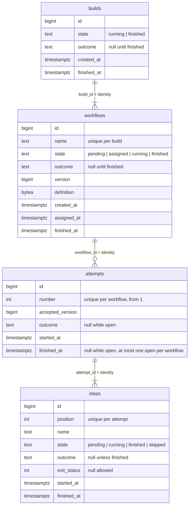

## Goal Capsule

- **Objective:** a database migrated by the store's first migration holds builds, workflows, attempts and steps, with their identity and lifecycle invariants enforced by Postgres, and the store opens, migrates and runs transactions.
- **Parent:** #20, part 3 of 5. Read it only for a question this part does not answer.
- **Open blockers:** none.

## Builds on

Already on main when this part starts; read the code, not these parts' files.

- Part 1 (U1): the state and outcome types, the snapshot types, and the conflict and not-found sentinels in `internal/model`.

## Product Contract

### Summary

This part adds `internal/store/postgres` with `Open`, `Close`, `Migrate` and `InTx`, the first migration with its four tables, and the harness that runs the store's tests against Postgres 18.

### Context

Every later part writes to these rows, and a merged migration is never edited, so the schema settles the identity and the states once.
U3 builds some of R10, which part 4 of this split completes, and of R11, which part 5 of this split completes.
Text copied from #20 says "part 1" to "part 7" for the parts of #4, of which #20 is part 2. This split's parts are "part k of this split" here and "Part k" under Builds on.

### Key Decisions

- **A workflow's state is separate from its outcome, and there are few states.** A state exists only where the engine treats the workflow differently. Why it waits (a runner, later a slot) is an attribute of the `crew.wait` span, not a state. Slice 2 adds `waiting` for dependencies. Governs R11. (session-settled: user-approved — chosen over one state per wait reason and over one status that mixes state and outcome.)
- **The repository's identity is host, organization and repository, parsed once from a URL; the URL is not kept.** This revises the architecture's "organization and repository on every row" by adding the host. Governs R10. (session-settled: user-directed — chosen over organization and repository alone, since two hosts can share names, and over storing the URL, since one repository has several URLs and a URL can carry a credential.)

### Scope Boundaries

- This part adds no primitive beyond `Open`, `Close`, `Migrate` and `InTx`. Creating, reading and handing out builds is part 4 of this split, attempts, steps and finishing are part 5 of this split.
- Attempts that fail for a lost runner and go back to `pending` (R14) belong to part 5. So does R26, which sets how the store's tests run against a real Postgres, since it also names the lost-runner end-to-end test.
- The `waiting` state for dependencies stays with slice 2.
- Considered and not built:
  - Lease columns, a lost reason on attempts, and trace or span ids on rows. Parts 5 and 6 each add the columns they need in their own migration (KTD9).
  - A `repositories` table. The identity lives on each row (R10), and nothing yet needs a repository to exist without a build.
  - Deleting or retaining old builds. Nothing asks for it. Foreign keys restrict deletes.

#### Deferred to Follow-Up Work

- `depguard` rules for the architecture's import rules, and the fix to `wrapcheck`'s glob that still names crew's module, belong to part 1 (#19). This part's imports already follow `docs/architecture.md` section 4.
- The architecture's decision-log entries for the base schema, the states and the host belong to part 7 (#25).

### Sources / Research

Split from #20.

- Issue #20, split from #4 (its lifecycle diagram, R13 to R17 and the Deferred to Planning questions show what the later parts expect from these rows).
- `docs/architecture.md`: section 3 (seam 2, "organization and repository on every row"), section 4 (package layout and import rules), section 6 (pgx v5, goose, testcontainers-go, PostgreSQL 18, and the macOS no-Docker skip), section 8 ("an open span is not exported", so spans read their start from rows), and D4, D6, D8 to D11.
- `docs/exploration/crew-actions.md`: "Database" (lease and version columns, migrations under an advisory lock).
- `.github/workflows/ci.yml` and `.testcoverage.yml`: `go test -race -coverpkg=./...` on Linux and macOS, and a 90% total coverage floor checked on Linux only.

---

## Planning Contract

### Key Technical Decisions

- KTD1. **One `postgres.Store` exposes small lifecycle primitives, and a transaction travels in the `context.Context`.** `Store.InTx(ctx, fn)` begins a transaction and passes `fn` a context that carries it. Every primitive joins the context's transaction when there is one, and otherwise runs in its own, so each primitive is atomic alone. No signature uses a pgx type. Primitives return `internal/model` types, and the conflict and not-found sentinels live in `internal/model`. So part 4's engine can declare its store interfaces with plain signatures, own the transactions (architecture section 4), and branch on errors without importing `store/postgres`. Rejected: an `InTx` callback that receives a store-specific `*Tx`, which would put a store type into every interface the engine declares.
- KTD2. **Four tables (`builds`, `workflows`, `attempts`, `steps`), with steps belonging to an attempt.** A new attempt starts from the first step, and each attempt's logs stay apart (parent R15, R21). So step rows per attempt keep attempt 1's history when attempt 2 runs. Ids are `bigint` identity columns, the plainest option, which needs no extra dependency.
- KTD3. **Identity on every row, kept equal to the parent's by composite foreign keys.** Each table has non-empty `host`, `organization` and `repository` columns. Each child references `(id, host, organization, repository)` of its parent, under a matching unique constraint. A child can therefore never disagree with its build, and no trigger is needed. Governs R10's "every row".
- KTD4. **States and outcomes are `text` columns with CHECK constraints, not Postgres enums.** Every table that has an outcome checks `(state = 'finished') = (outcome IS NOT NULL)`. The outcome check allows `success` and `failure` only (D4). Slice 2's `waiting` then becomes one migration that replaces a constraint, while a new enum value cannot be used in the transaction that adds it. Governs R11.
- KTD5. **`workflows.version` goes up on every state change, and accepting compares it.** Hand-out returns the version, and starting an attempt succeeds only with that version while the workflow is `assigned`. This is D6's version column. It also fences a late accept after part 5 sends an unaccepted workflow back to `pending`. `assigned_at` records the hand-out for part 5's accept timeout (R13).
- KTD6. **Every call after accept names its attempt, and a workflow has at most one open attempt.** Step and finish primitives take the attempt id and refuse an attempt that has already ended. A partial unique index on `attempts(workflow_id) WHERE finished_at IS NULL` holds the "one open attempt" rule in the database. This way a runner part 5 has given up on cannot finish the attempt that replaced its own.
- KTD9. **goose's Provider API runs the embedded migrations under its Postgres session locker.** goose takes the advisory lock that D10 relies on only when it is given that locker explicitly. goose needs a `*sql.DB`, which comes from the store's pgx pool through pgx's `stdlib` adapter, so only `store/postgres` imports pgx and goose. Migrations are numbered `00001_…`, and a merged migration is never edited, since goose tracks versions, not contents.
- KTD12. **A workflow's compiled definition is stored as opaque `bytea`.** The engine (part 4) needs it to survive a restart, so it can hand it out. Its shape is part 3's and part 4's to choose, so the store neither parses nor validates it.

### High-Level Technical Design

**Schema (KTD2, KTD3, KTD5, KTD6, KTD12).** Every table also has `host`, `organization` and `repository`, all non-empty. Each foreign key includes them.

**Store surface (KTD1).** Each primitive is atomic alone, and composes with others under `InTx`. A row in an unexpected state gives the conflict sentinel (KTD7).

| Primitive | Effect |
|---|---|
| `Open`, `Close`, `Migrate` | Pool from a database URL. `Migrate` applies the embedded migrations under goose's lock. |
| `InTx` | Runs a function with a transaction in its context. A returned error rolls back. |

### Assumptions

These are bets nobody confirmed (headless run). Each one is recorded so a reviewer can overturn it.

- **The store's tests start Postgres with testcontainers-go, once per test package, migrate it with the store's own `Migrate`, and empty the tables between tests.** They skip when Docker is missing. R26's database per test from a migrated template (pgtestdb) stays with part 5, as the Scope Boundaries say. Tests still need a real database now, because the 90% coverage floor counts the store's code.
- **The Postgres image in tests is `postgres:18`, by major only.** This follows D15. Nothing pins a minor in Go code that Dependabot cannot move.
- **CI needs no change.** The Linux job has Docker, and if the store's tests skipped there, the coverage floor would fail the run. The macOS job skips them, as architecture section 6 says.

### Sequencing

U3 is the only unit. It needs part 1's types.

---

## Implementation Units

### U3. Store foundation: dependencies, first migration, open, migrate, transactions

**Goal:** a database migrated by the store's first migration holds the four tables of R10 and R11, with their invariants enforced by Postgres.

**Requirements:** R10, R11; KTD1 to KTD6, KTD9, KTD12.

**Dependencies:** U1.

**Files:**
- Modify `go.mod` and `go.sum` (add `github.com/jackc/pgx/v5`, `github.com/pressly/goose/v3`, `github.com/testcontainers/testcontainers-go` and its Postgres module).
- Create `internal/store/postgres/store.go` (package doc, `Open`, `Close`, `InTx`, the context-carried transaction and the helper primitives use to join it).
- Create `internal/store/postgres/migrate.go` (the embedded `migrations` directory and `Migrate`).
- Create `internal/store/postgres/migrations/00001_builds_workflows_attempts_steps.sql`.
- Create `internal/store/postgres/main_test.go` (the harness) and `internal/store/postgres/migrate_test.go`.
- Delete `internal/store/postgres/.gitkeep`.

**Approach:**
- The migration creates the schema drawn in the High-Level Technical Design, including:
  - the identity columns with non-empty checks, plus the unique constraints and composite foreign keys of KTD3;
  - the state, outcome and timestamp checks of KTD4, with `finished_at` set exactly when a row is finished (or skipped, for steps);
  - `UNIQUE (build_id, name)` on workflows, `UNIQUE (workflow_id, number)` on attempts and `UNIQUE (attempt_id, position)` on steps;
  - the partial unique index of KTD6;
  - a partial index on pending workflows by `created_at`, for the hand-out query.
- A comment in the migration says that outcomes stay `success` and `failure` only (D4), so part 5's lost reason gets a column of its own.
- Its `Down` section drops the tables.
- `Migrate` builds a goose provider over the embedded files with the Postgres session locker (KTD9), using a `*sql.DB` opened from the pool and closed afterwards.
- Errors from pgx and goose are wrapped with what was being done.
- Harness: `TestMain` starts one Postgres 18 container, migrates it, and records its URL. A helper gives each test a store on that database, after emptying the tables. When Docker is unavailable, the helper skips the test with a message saying why.

**Patterns to follow:** architecture section 6 (goose reads `embed.FS`, PostgreSQL 18). `gochecknoglobals` allows a `//go:embed` variable, and it is already excluded in `_test.go` files (`.golangci.yml`).

**Test scenarios:**
- `Migrate` on an empty database creates the four tables, and a second `Migrate` is a no-op.
- Two `Migrate` calls running at once both succeed, and the schema is applied once.
- Migrating down to zero and up again leaves a working schema.
- Inserting a workflow whose identity differs from its build's fails on the foreign key.
- Inserting a row with an empty host, organization or repository fails its check.
- A workflow `pending` with an outcome, and a workflow `finished` without one, each fail their check.
- An outcome of `lost` fails its check.
- A second open attempt for one workflow fails on the partial unique index.
- `InTx` commits when its function returns nil, and rolls back every write when the function returns an error.
- `Open` with an unreachable URL returns a wrapped error and no store.

**Verification:** the store's tests pass with Docker, and skip with a clear message without it. `go mod tidy` leaves `go.mod` unchanged.

---

## Verification Contract

| Gate | Command or check | Applies to |
|---|---|---|
| Modules tidy | `go mod tidy` leaves `go.mod` and `go.sum` unchanged | U3 |
| Format and vet | `gofmt -l cmd internal` prints nothing, and `go vet ./...` passes | all |
| Lint | golangci-lint v2.14.0 (`go run github.com/golangci/golangci-lint/v2/cmd/golangci-lint@v2.14.0 run`) passes with `.golangci.yml` as it is | all |
| Tests | `go test -race -covermode=atomic -coverpkg=./... -coverprofile=coverage.out ./...` passes with Docker running, and the store's tests skip cleanly without Docker | all |
| Coverage floor | the total in `coverage.out` is at least 90% (`.testcoverage.yml`) | all |
| Vulnerabilities | `go tool govulncheck ./...` reports nothing for the new modules | U3 |

---

## Definition of Done

- Every gate in the Verification Contract passes, locally with Docker and in CI's Linux and macOS jobs.
- `internal/model` imports nothing that does I/O. pgx, goose and the generated queries are imported only under `internal/store/postgres`.
- No command, protocol call, lease column or telemetry code was added.
- The `.gitkeep` files in `internal/model` and `internal/store/postgres` are gone, and no dead-end or experimental code from abandoned approaches is left in the diff.

<!-- cw-split-ce-plan: part of #20 -->

<!-- publish-split: part 3 of #20 -->

