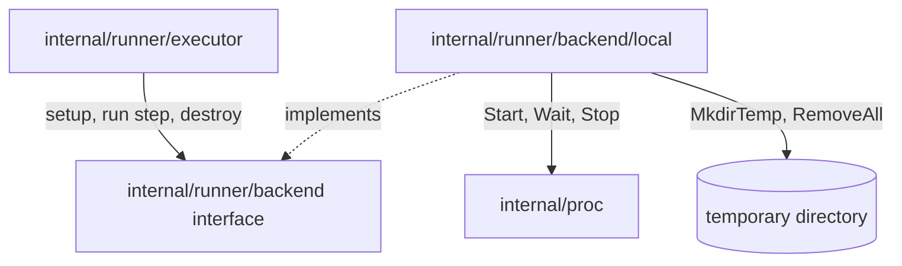

## Goal Capsule

- **Objective:** an attempt gets a new, empty directory, its steps run in it as one POSIX shell each through `internal/proc`, and the directory is removed at the end.
- **Parent:** #21, part 3 of 4. Read it only for a question this part does not answer.
- **Open blockers:** none.

## Builds on

Already on main when this part starts; read the code, not these parts' files.

- Part 1 (U1): `internal/proc`, crew's copy, with its `*proc.Group`, `Start`, `Wait` and `Stop`.
- Part 2 (U2): `internal/spec`, with `spec.Parse`, `spec.NameFromPath` and the workflow and step types, and `go.yaml.in/yaml/v3` as a direct dependency.

## Product Contract

### Summary

The backend interface in `internal/runner/backend` (set up an attempt's workspace, run a step in it, destroy it) and the `local` backend that implements it with a temporary directory and `/bin/sh -c`.

### Context

This settles how a step fails and where an attempt runs before any executor or protocol exists. U3 also builds part of R18, which Part 4's executor completes by destroying the workspace whatever the attempt's end. In text copied from #21, "part 2" to "part 7" name #4's parts, such as part 2 (#20); this split's parts are Part 1 to Part 4.

### Key Decisions

- **Each attempt runs in a new, empty directory that is removed when it ends.** Whether a workspace is reused is the checkout's decision, which slice 1 makes. Governs R18. (session-settled: user-directed — chosen over the directory the runner started in and over a directory sent by `run`: a repeated attempt starts clean.)

### Requirements

**The workflow file**

- R6. A file holds one workflow, named after the file's base name, with steps that each have a `name` and `commands`; a step fails when one of its commands fails, and its later commands do not run.

**The runner**

- R20. Step processes start through the copy of crew's `internal/proc` that `docs/architecture.md` D16 describes.

### Key Flows

- F1. Run a file by hand
  - **Trigger:** a person, inside a git repository, runs `crew-actions run test.yaml` with an engine and a runner up.
  - **Steps:** `run` parses the identity and sends the file; the engine checks it and creates the build with its workflow `pending`; the runner asks, accepts and runs the steps in a new directory, sending states and output; `run` prints them as they come; the runner reports `done`.
  - **Outcome:** `run` exits 0 or 1 with the build's outcome, and the build, workflow, attempt and steps are rows with their logs on disk.
  - **Covered by:** R1, R2, R3, R6, R9, R11, R12, R18, R21

### Scope Boundaries

- Ordering an attempt's steps, skipping those after a failure and reporting each step's end are Part 4's executor's. Nothing calls the backend yet outside its tests.
- Cleaning up the directory a killed runner leaves behind is not done.
- Hooks, `when`, `depends_on` and the `docker` backend stay with their slices.
- The `dummy` backend arrives with #4's part 5's end-to-end test (R26).
- Spans, `crew.step.exit_status` and the `TRACEPARENT` variable are #4's part 6's.
- Rewriting `docs/architecture.md` is #4's part 7's, including section 4's wording that the backend sets up "a step's environment": here it sets up an attempt's, because the steps share one workspace (D3).
- `.golangci.yml` stays as it is: #19 owns its rules.

Considered and not built:

- Tracking a step's processes that leave its process group with `setsid`. They can outlive the step and write into the directory after removal. Destroy's error reports a removal that fails because of them. Evidence that steps routinely start daemons would change this.
- Stopping a killed runner's step processes. Each step runs in its own process group, so `kill -9` on the runner leaves them running. This belongs to part 5, which owns the lost runner. Linux's parent-death signal reaches only the direct child and does not exist on macOS, so it would not close the gap.
- An environment parameter on the backend's run call. Only part 6's `TRACEPARENT` would use it, and adding it then is one signature change in an internal package.
- Any isolation of the local backend. A step can `cd` out of the workspace and write anywhere the runner can. Containers are slice 8.

### Sources / Research

Split from #21.

- `docs/architecture.md`: section 4 (packages and import rules) and the decision log (D3, D16).
- crew's `internal/adapter/shell/shell.go`: an injected `proc.Group`, `Start` with one writer for stdout and stderr, `Wait` in a goroutine, and `Stop` with a 10-second stop timeout when the context ends.

## Planning Contract

### Key Technical Decisions

- KTD1. **Four packages, placed as the architecture's section 4 places them.** `internal/proc` is the copy (R20). `internal/spec` parses the file (R6). `internal/runner/backend` declares the backend interface, and `internal/runner/backend/local` implements it. `internal/runner/executor` runs one workflow's steps (R12). Each local implementation is a subpackage, as `runner/backend/docker` will be. No package imports `internal/model`, which part 2 (#20) creates in parallel: this part must merge alone, and part 4 maps the executor's results onto the model's states.
- KTD6. **A step is one POSIX shell, `/bin/sh -c`, with an exit-status check after each command.** The backend builds the script: each command, a blank line, then a line that exits with the command's status when it is not zero. `cd` and `export` carry across a step's commands, as authors of multi-command steps expect, but not into the next step. Every step starts at the workspace's root. The blank line ends a command that finishes with a `\` line continuation before the check. Each command must be a complete shell command on its own: a heredoc ends inside its command, and no command ends with `|`, `&&` or `||`. Otherwise the commands and checks after it become part of it, and the step can exit 0 without running them. A step's exit status is that of its failing command (R6). A command that runs `exit 0` ends its step with success and skips the step's remaining commands. Rejected: one shell per command, which loses `cd` and `export` between commands. Rejected: a `set -e` script, which does not stop on a failure inside an `&&` list, contrary to R6. Rejected: an `eval` loop over positional arguments, which shows the other commands in `$@`, lets `break` end the step with success, and turns off a user's `set -e`.
- KTD7. **The backend owns the attempt's workspace: set up, run steps in it, destroy.** The local backend's setup creates the directory with `os.MkdirTemp` under a base directory, `os.TempDir()` by default and settable for tests, with a fixed `crew-actions-` prefix so a directory left behind is easy to find (R18). Destroy removes it. When removal fails, as on a directory a step made read-only, destroy gives the tree's directories owner write permission, tries once more, and returns the error if removal still fails. The backend takes the `*proc.Group` from its caller, so part 5 can stop every step process at once. (session-settled: user-directed — chosen over the directory the runner started in and over a directory sent by `run`: a repeated attempt starts clean.) Governs R18.
- KTD9. **A cancelled attempt is stopped, not failed.** When the context ends, the backend stops the running step's process group with `proc`'s `Stop`. It gets a grace context derived with `context.WithoutCancel`, 10 seconds by default and settable, because the run's context is already done and passing it would make `Stop` kill at once. The executor reports that step as finished and stopped, reports the rest as skipped, and returns an error wrapping the context's error, with no outcome. Part 5 decides what a stopped attempt means (a lost runner). When a step exits on its own before the cancellation is seen, its real result stands.
- KTD12. **Errors are wrapped where they cross a package.** `wrapcheck` runs, and its ignore list names crew's module, not this one. Wrapping costs nothing, and changing the lint config is #19's.

### High-Level Technical Design

How the packages call each other:



The step script KTD6 describes, shown for two commands. This sketch is directional, and the implementer picks the exact text and the variable's name:

```sh
cd src

crew_status=$?; [ "$crew_status" -eq 0 ] || exit "$crew_status"
make

crew_status=$?; [ "$crew_status" -eq 0 ] || exit "$crew_status"
```

### Output Structure

```text
internal/runner/backend/backend.go
internal/runner/backend/local/local.go
internal/runner/backend/local/local_test.go
```

The `.gitkeep` file in `internal/runner/backend` is removed once that folder holds code.

### Assumptions

These are inferred, unconfirmed bets.

- `/bin/sh` is the only shell, and the format has no `shell` key. Bash-only syntax (`[[`, `pipefail`) works on macOS, where `/bin/sh` is bash, and fails on Linux, where it is dash. The package documentation says steps run under POSIX sh.
- The stop grace period defaults to 10 seconds, the timeout crew's shell adapter uses. Part 5 may shorten it for the runner's second signal.
- Steps inherit the runner's whole environment, plus the two prompt settings `proc` always adds. Nothing is unset.

### Sequencing

U3 alone, once Parts 1 and 2 are on main.

### Risks

- **dash and bash differ.** Linux CI runs the backend's tests under dash and macOS under bash. KTD6's script uses only POSIX constructs, and the backend's tests run on both matrix jobs, so a difference shows in CI.
- **The coverage floor is 90% of the whole module.** The module is small, so untested error branches pull the total down. The base-directory and grace-period options exist so the setup failure and the SIGKILL path can be tested quickly.

## Implementation Units

### U3. The backend interface and the local backend

**Goal:** an attempt gets a new, empty directory, its steps run in it as one shell each through `proc`, and the directory is removed at the end.

**Requirements:** R6, R18, R20; KTD6, KTD7, KTD9, KTD12.

**Dependencies:** U1, U2.

**Files:**
- Create `internal/runner/backend/backend.go`, `internal/runner/backend/local/local.go` and `internal/runner/backend/local/local_test.go`.
- Delete `internal/runner/backend/.gitkeep`.

**Approach:**
- `backend` declares the interface: set up an attempt's workspace, run a step in it with one output writer, destroy it. A step run returns its exit status, or an error when the step could not start or was stopped.
- `local` takes the `*proc.Group`, the base directory and the grace period as construction options, with the defaults of KTD7 and KTD9.
- A step runs `/bin/sh -c` with KTD6's script, `Dir` set to the workspace, and the writer as both stdout and stderr.
- Waiting and cancellation follow crew's shell adapter: `Wait` in a goroutine, a `select` on it and the context, then `Stop` with the grace context of KTD9.
- The exit status comes from the `*exec.ExitError` that `Wait` wraps. When the shell itself was killed by a signal, there is no exit status.

**Patterns to follow:** crew's `internal/adapter/shell/shell.go`.

**Test scenarios:**
- Two setups give two different directories, both existing and empty.
- A step running `pwd` prints the workspace's path. Compare after `filepath.EvalSymlinks`, since macOS's temporary directory sits under a symlink.
- A step of `echo one` then `echo two` exits 0 and writes `one` then `two` to the writer.
- A step whose command writes to stdout then stderr delivers both to the writer in that order.
- `mkdir sub` then `cd sub` then `pwd` prints the `sub` path, and the next step's `pwd` prints the workspace's root.
- `export X=1` then `echo "$X"` prints `1`, and the next step's `echo "${X:-unset}"` prints `unset`.
- `false` then `echo after` exits 1 and never prints `after`.
- `true`, then `exit 3`, then `echo after` exits 3 and never prints `after`.
- `echo a \` followed by `false` prints `a` and exits 1: the trailing continuation does not swallow the check.
- `echo first` then `echo "unbalanced` exits non-zero.
- `set -e; false; echo after` as one command exits 1 without printing `after`.
- `true && false` as one command exits 1.
- A command `cat <<EOF` with no terminator line, followed by `false`, pins today's behavior: the step exits 0 and `false` never runs, so a later change to the script's shape is deliberate.
- A step running `sleep 30` stops within the grace period when the context is cancelled. The run returns an error wrapping `context.Canceled`, and `sleep`'s process is gone.
- A step that ignores SIGTERM (`trap '' TERM; sleep 30`) is killed once a short grace period passes.
- A step run after its workspace was removed fails to start and returns an error with no exit status.
- Destroy removes the workspace and everything a step wrote in it.
- Destroy removes a tree in which a step ran `mkdir d && touch d/f && chmod 555 d`.
- Destroy of a workspace already removed returns nil.
- Setup under a base directory that does not exist returns an error.

**Verification:** every scenario passes under the race detector on Linux (dash) and macOS (bash).

## Verification Contract

| Gate | Command | Passes when |
|---|---|---|
| Tests | `go test -race -covermode=atomic -coverpkg=./... -coverprofile=coverage.out ./...` | every test passes, on Linux and on macOS |
| Coverage | go-test-coverage with `.testcoverage.yml`, as CI runs it on the Linux job | the module's total stays at or above 90% |
| Vet | `go vet ./...` | no finding |
| Lint | golangci-lint v2.14.0 with `.golangci.yml` | no finding, and no new `//nolint` beyond those copied with `proc` |
| Vulnerabilities | `go tool govulncheck ./...` | no finding reachable from the new dependency |

## Definition of Done

- `internal/spec` imports nothing that does I/O, and no new package imports `internal/model`.
- The `.gitkeep` files of the folders that now hold code are gone.
- Every gate of the Verification Contract passes: the coverage floor on the Linux job, the others on both CI jobs.
- No dead-end or experimental code from abandoned approaches is left in the diff.

<!-- cw-split-ce-plan: part of #21 -->

<!-- publish-split: part 3 of #21 -->

