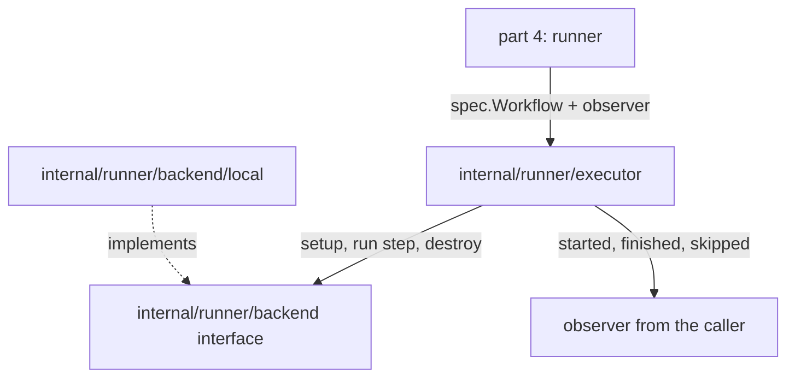

## Goal Capsule

- **Objective:** a workflow's steps run in order in one attempt's workspace, a failing step fails the workflow and skips the steps after it, and the caller sees every step end exactly once.
- **Parent:** #21, part 4 of 4. Read it only for a question this part does not answer.
- **Open blockers:** none.

## Builds on

Already on main when this part starts; read the code, not these parts' files.

- Part 3 (U3): the backend interface in `internal/runner/backend` (set up a workspace, run a step with one writer, destroy) and the `local` backend in `internal/runner/backend/local`, built on Part 1's `internal/proc` and Part 2's `internal/spec`, both on main too.

## Product Contract

### Summary

The executor in `internal/runner/executor`: it takes a `spec.Workflow`, a backend and an observer, runs the steps in order, reports how each ends, and destroys the workspace whatever happens.

### Context

The runner of #4's part 4 runs its workflows with this; it settles the step endings and the workflow's outcome before any protocol exists. In text copied from #21, "part 2" to "part 7" name #4's parts, such as part 2 (#20); this split's parts are Part 1 to Part 4.

### Key Decisions

- **A workflow's state is separate from its outcome, and there are few states.** A state exists only where the engine treats the workflow differently; why it waits (a runner, later a slot) is the `crew.wait` span's attribute, not a state. Slice 2 adds `waiting` for dependencies. Governs R11, R12. (session-settled: user-approved — chosen over one state per wait reason and over one status that mixes state and outcome.)
- **Each attempt runs in a new, empty directory that is removed when it ends.** Whether a workspace is reused is the checkout's decision, which slice 1 makes. Governs R18. (session-settled: user-directed — chosen over the directory the runner started in and over a directory sent by `run`: a repeated attempt starts clean.)

### Requirements

**Lifecycle**

- R12. Steps run in order, and when one fails the workflow fails and the steps after it end `skipped`.

**The runner**

- R18. Each attempt runs in a new, empty temporary directory, removed when the attempt ends; a killed runner's directory is left behind.

### Key Flows

- F1. Run a file by hand
  - **Trigger:** a person, inside a git repository, runs `crew-actions run test.yaml` with an engine and a runner up.
  - **Steps:** `run` parses the identity and sends the file; the engine checks it and creates the build with its workflow `pending`; the runner asks, accepts and runs the steps in a new directory, sending states and output; `run` prints them as they come; the runner reports `done`.
  - **Outcome:** `run` exits 0 or 1 with the build's outcome, and the build, workflow, attempt and steps are rows with their logs on disk.
  - **Covered by:** R1, R2, R3, R6, R9, R11, R12, R18, R21
- F2. The M0 demonstration
  - **Trigger:** the file declares `retry.automatic` with `when: lost`, and the person kills the runner midway.
  - **Steps:** the lease stops being renewed and expires; the engine ends attempt 1 as lost and returns the workflow to `pending`; the person starts a runner again; it takes attempt 2 and runs it from the first step in a clean directory.
  - **Outcome:** the build finishes, `run` has followed it throughout, and the trace shows both attempts.
  - **Covered by:** R7, R14, R15, R18, R23

### Scope Boundaries

- This part adds no command: the `runner` that uses it, and refusing a file with a key slice 0 does not implement (R8), are part 4's; `retry` (R7) is part 5's. The acceptance example for R12, AE7, is part 4's, where `run` exits 1; this part proves the same step endings at the executor's level.
- The `dummy` backend arrives with part 5's end-to-end test (R26); the executor's tests here use a fake backend inside the test file.
- Spans, `crew.step.exit_status` and the `TRACEPARENT` variable are part 6's.
- Hooks, `when`, `depends_on` and the `docker` backend stay with their slices.
- `.golangci.yml` stays as it is: #19 owns its rules.

### Sources / Research

Split from #21.

- `docs/architecture.md`: section 4 (packages and import rules) and the decision log (D3).

## Planning Contract

### Key Technical Decisions

- KTD1. **Four packages, placed as the architecture's section 4 places them.** `internal/proc` is the copy (R20). `internal/spec` parses the file (R6). `internal/runner/backend` declares the backend interface, and `internal/runner/backend/local` implements it. `internal/runner/executor` runs one workflow's steps (R12). Each local implementation is a subpackage, as `runner/backend/docker` will be. No package imports `internal/model`, which part 2 (#20) creates in parallel: this part must merge alone, and part 4 maps the executor's results onto the model's states.
- KTD8. **Every step ends exactly once, reported to an observer in step order.** The executor calls the observer from its own goroutine. A step that ran is reported as started, then finished with its exit status or the error that kept it from starting. A step that did not run is reported as skipped (R12). The workflow fails when any step finishes with failure. The executor's result types are its own, because part 2's `internal/model` is not on main yet (KTD1). (session-settled: user-approved — chosen over one state per wait reason and over one status that mixes state and outcome.) Governs R12.
- KTD9. **A cancelled attempt is stopped, not failed.** When the context ends, the backend stops the running step's process group with `proc`'s `Stop`. It gets a grace context derived with `context.WithoutCancel`, 10 seconds by default and settable, because the run's context is already done and passing it would make `Stop` kill at once. The executor reports that step as finished and stopped, reports the rest as skipped, and returns an error wrapping the context's error, with no outcome. Part 5 decides what a stopped attempt means (a lost runner). When a step exits on its own before the cancellation is seen, its real result stands.
- KTD10. **The executor hands `proc` one writer per step, which never fails.** It wraps the observer's writer in a pointer type that always reports a full write and keeps the first error, and passes that same value as stdout and stderr. `proc` ignores a copy error, so a failing writer would stop draining the pipe and the child would block forever once the pipe filled. One comparable value also gives one pipe, so output stays in order and nothing writes concurrently. The observer's writer must not block for long. Part 4, whose writer sends the `log` call, buffers. A kept write error is reported in the step's result and never changes its outcome.
- KTD11. **The workspace is destroyed even when the attempt is cancelled or an observer panics.** The executor destroys it in a deferred call with a context from `context.WithoutCancel`. A removal error is returned beside the result and never turns success into failure. When setup fails, every step is skipped and the setup error is returned.
- KTD12. **Errors are wrapped where they cross a package.** `wrapcheck` runs, and its ignore list names crew's module, not this one. Wrapping costs nothing, and changing the lint config is #19's.

### High-Level Technical Design

How the packages call each other:



How each step ends, by situation (KTD8, KTD9, KTD11):

| Situation | Steps before | This step | Steps after | Run returns |
|---|---|---|---|---|
| Every step exits 0 | finished, success | — | — | success |
| Step N exits non-zero | finished, success | finished, failure, its exit status | skipped | failure |
| Step N cannot start | finished, success | finished, failure, start error, no exit status | skipped | failure |
| Setup fails | — | — | all skipped | the setup error |
| Context done before setup | — | — | all skipped, no directory made | the context's error |
| Context done between steps | finished, success | — | skipped | the context's error |
| Context done during step N | finished, success | finished, stopped | skipped | the context's error |
| Removal fails | unchanged | unchanged | unchanged | the outcome, plus the removal error |

### Output Structure

```text
internal/runner/executor/executor.go
internal/runner/executor/executor_test.go
```

The `.gitkeep` file in `internal/runner/executor` is removed once that folder holds code.

### Assumptions

These are inferred, unconfirmed bets.

- Part 2 (#20) and this part merge in either order. The executor imports nothing from `internal/model`. Part 4 maps the executor's step endings onto the model's states and the protocol's `update` call.
- The workspace's path is not reported to the observer. A directory left behind is found by its `crew-actions-` prefix under the temporary directory.

### Sequencing

U4 alone, once Part 3 is on main.

## Implementation Units

### U4. The executor

**Goal:** a workflow's steps run in order in one attempt's workspace, a failing step fails the workflow and skips the rest, and the caller sees every step end exactly once.

**Requirements:** R12, R18; KTD8, KTD9, KTD10, KTD11, KTD12.

**Dependencies:** U2, U3.

**Files:**
- Create `internal/runner/executor/executor.go` and `internal/runner/executor/executor_test.go`.
- Delete `internal/runner/executor/.gitkeep`.

**Approach:**
- `Run` takes a context, a `spec.Workflow`, a backend and an observer. It returns the workflow's outcome, or an error when the attempt did not reach one (KTD9, KTD11).
- The observer has one call for a step that starts, which returns the step's writer, one for a step that finishes, with the step's result, and one for a step that is skipped.
- The step result holds the exit status, or none, the start or stop error, whether the step was stopped, and the writer's kept error (KTD10).
- The package documentation states the observer's contract: calls come in step order from `Run`'s goroutine, and the writer must not block for long.

**Execution note:** write the executor's tests against a fake backend in the test file, then add one test with the local backend for what a fake cannot prove: the directory and the pipe.

**Test scenarios:**
- Covers AE7. Three steps where the second fails: the observer sees step 1 started then finished with success, step 2 started then finished with failure and its exit status, step 3 skipped. `Run` returns failure and no error.
- Three steps that all succeed: three started and finished pairs, in order, and success.
- A context cancelled before `Run`: every step skipped, setup never called, and an error wrapping `context.Canceled`.
- A context cancelled while step 2 runs: step 2 finished and stopped, step 3 skipped, destroy called, and an error wrapping `context.Canceled`.
- A context cancelled between steps 1 and 2: step 1 finished with success, steps 2 and 3 skipped, and the context's error.
- Setup fails: every step skipped, and the setup error returned.
- Step 2 cannot start: step 2 finished with failure, the start error and no exit status, step 3 skipped, and failure.
- Destroy fails after every step succeeded: success, with the removal error beside it.
- An observer that panics in its step-finished call: destroy still runs.
- With the local backend, a workflow whose first step writes a file and second step lists it: the second step's output names the file. After `Run`, the workspace is gone. A second `Run` starts in a different, empty directory.
- With the local backend, a step printing more than 64 KiB to an observer writer that fails on its first write: the step finishes with success, and its result holds the write error.

**Verification:** every scenario passes under the race detector. The executor imports neither `internal/model` nor any `engine`, `scheduler` or `store` package.

## Verification Contract

| Gate | Command | Passes when |
|---|---|---|
| Tests | `go test -race -covermode=atomic -coverpkg=./... -coverprofile=coverage.out ./...` | every test passes, on Linux and on macOS |
| Coverage | go-test-coverage with `.testcoverage.yml`, as CI runs it on the Linux job | the module's total stays at or above 90% |
| Vet | `go vet ./...` | no finding |
| Lint | golangci-lint v2.14.0 with `.golangci.yml` | no finding, and no new `//nolint` beyond those copied with `proc` |
| Vulnerabilities | `go tool govulncheck ./...` | no finding reachable from the new dependency |

## Definition of Done

- R6, R12, R18 and R20 hold, each shown by the test scenarios of the units that cite it.
- `internal/spec` imports nothing that does I/O, and no new package imports `internal/model`.
- The `.gitkeep` files of the folders that now hold code are gone.
- Every gate of the Verification Contract passes: the coverage floor on the Linux job, the others on both CI jobs.
- No dead-end or experimental code from abandoned approaches is left in the diff.

<!-- cw-split-ce-plan: part of #21 -->

<!-- publish-split: part 4 of #21 -->

