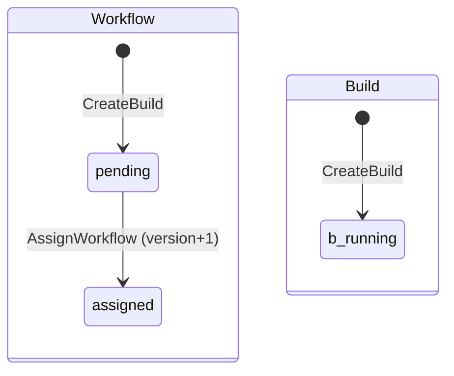

## Goal Capsule

- **Objective:** a build can be created with its repository identity and its pending workflows, read back as a whole, and its workflows handed out.
- **Parent:** #20, part 4 of 5. Read it only for a question this part does not answer.
- **Open blockers:** none.

## Builds on

Already on main when this part starts; read the code, not these parts' files.

- Part 2 (U2): `model.Repository` and its parser, which `CreateBuild` takes.
- Part 3 (U3): `internal/store/postgres` with `Open`, `Close`, `Migrate` and `InTx`, the first migration's four tables, and the store's test harness.

## Product Contract

### Summary

This part adds `CreateBuild`, `GetBuild`, `PendingWorkflows` and `AssignWorkflow`, and the sqlc setup that generates the store's queries.
A build now carries the parsed identity on every row, and its workflow moves `pending → assigned`.

### Context

These are the primitives #4's part 4 composes to accept a file and hand its workflow to a runner.
U4 builds some of R11, which part 5 of this split completes.
Text copied from #20 says "part 1" to "part 7" for the parts of #4, of which #20 is part 2. This split's parts are "part k of this split" here and "Part k" under Builds on.

### Key Decisions

- **A workflow's state is separate from its outcome, and there are few states.** A state exists only where the engine treats the workflow differently. Why it waits (a runner, later a slot) is an attribute of the `crew.wait` span, not a state. Slice 2 adds `waiting` for dependencies. Governs R11. (session-settled: user-approved — chosen over one state per wait reason and over one status that mixes state and outcome.)
- **The repository's identity is host, organization and repository, parsed once from a URL; the URL is not kept.** This revises the architecture's "organization and repository on every row" by adding the host. Governs R10. (session-settled: user-directed — chosen over organization and repository alone, since two hosts can share names, and over storing the URL, since one repository has several URLs and a URL can carry a credential.)

### Requirements

**Identity**

- R10. Parsing drops any user, credential, scheme and `.git` suffix, and puts nested groups in the organization. Every row carries host, organization and repository from the first migration.

### Key Flows

- F1. Run a file by hand
  - **Trigger:** a person, inside a git repository, runs `crew-actions run test.yaml` with an engine and a runner up.
  - **Steps:** `run` parses the identity and sends the file. The engine checks it and creates the build with its workflow `pending`. The runner asks for work, accepts it, and runs the steps in a new directory, sending states and output. `run` prints them as they come. The runner reports `done`.
  - **Outcome:** `run` exits 0 or 1 with the build's outcome, and the build, workflow, attempt and steps are rows, with their logs on disk.
  - **Covered by:** R1, R2, R3, R6, R9, R11, R12, R18, R21 (this part supplies the rows and the identity parsing that R10 and R11 ask for. The rest is in other parts.)

### Scope Boundaries

- This part creates, reads and hands out builds only. Attempts, steps and finishing workflows and builds are part 5 of this split.
- The commands that use the store, `run` reading the `origin` remote or `--repo` (R9), and the identity example AE8 belong to #4's part 4.
- Considered and not built:
  - Idempotent repeats of a transition (R17's retries). They belong to part 5, which owns R17. Every repeat is a conflict here (KTD7).
  - `pg_notify` on writes, for `next`'s long poll and `run`'s live follow. This belongs to part 4, inside its own transactions.

#### Deferred to Follow-Up Work

- A CI check that sqlc's generated code matches the queries. This part commits the generated code and records how to regenerate it (KTD10).

### Sources / Research

Split from #20.

- `docs/architecture.md`: section 3 (seam 2, "organization and repository on every row"), section 4 (package layout and import rules), section 6 (pgx v5, sqlc), and D6, D8 to D11.
- `docs/exploration/crew-actions.md`: "Database" (lease and version columns, migrations under an advisory lock).
- `.github/workflows/ci.yml` and `.testcoverage.yml`: `go test -race -coverpkg=./...` on Linux and macOS, and a 90% total coverage floor checked on Linux only.

---

## Planning Contract

### Key Technical Decisions

- KTD1. **One `postgres.Store` exposes small lifecycle primitives, and a transaction travels in the `context.Context`.** `Store.InTx(ctx, fn)` begins a transaction and passes `fn` a context that carries it. Every primitive joins the context's transaction when there is one, and otherwise runs in its own, so each primitive is atomic alone. No signature uses a pgx type. Primitives return `internal/model` types, and the conflict and not-found sentinels live in `internal/model`. So part 4's engine can declare its store interfaces with plain signatures, own the transactions (architecture section 4), and branch on errors without importing `store/postgres`. Rejected: an `InTx` callback that receives a store-specific `*Tx`, which would put a store type into every interface the engine declares.
- KTD3. **Identity on every row, kept equal to the parent's by composite foreign keys.** Each table has non-empty `host`, `organization` and `repository` columns. Each child references `(id, host, organization, repository)` of its parent, under a matching unique constraint. A child can therefore never disagree with its build, and no trigger is needed. Governs R10's "every row".
- KTD5. **`workflows.version` goes up on every state change, and accepting compares it.** Hand-out returns the version, and starting an attempt succeeds only with that version while the workflow is `assigned`. This is D6's version column. It also fences a late accept after part 5 sends an unaccepted workflow back to `pending`. `assigned_at` records the hand-out for part 5's accept timeout (R13).
- KTD7. **Transitions are strict compare-and-set updates.** Each primitive moves a row from one named state to the next (`UPDATE … WHERE state = <from>`). A row in any other state gives the model's conflict sentinel, and a missing row gives not-found. Repeats are conflicts too (see Scope Boundaries).
- KTD10. **sqlc generates the ordinary queries into `internal/store/postgres/queries`, for pgx v5, and the generated code is committed.** sqlc runs from its release binary, not the `tool` directive (architecture section 6), and `sqlc.yaml` records the version used and the command. Only the queries the primitives use are written, so no untested generated code counts against the coverage floor. The hand-out query (`FOR UPDATE SKIP LOCKED`) is an ordinary query. The claim loop around it is part 4's, written by hand (D9).
- KTD12. **A workflow's compiled definition is stored as opaque `bytea`.** The engine (part 4) needs it to survive a restart, so it can hand it out. Its shape is part 3's and part 4's to choose, so the store neither parses nor validates it.

### High-Level Technical Design

**Lifecycles (R11, KTD4, KTD8).**

**Store surface (KTD1).** Each primitive is atomic alone, and composes with others under `InTx`. A row in an unexpected state gives the conflict sentinel (KTD7).

| Primitive | Effect |
|---|---|
| `CreateBuild` | Inserts a `running` build and its `pending` workflows, which take the build's identity. |
| `GetBuild` | Snapshot of a build with all its workflows, every attempt and every attempt's steps. |
| `PendingWorkflows` | Locks up to N `pending` workflows, oldest first, with `FOR UPDATE SKIP LOCKED`. Meant to run inside `InTx`. |
| `AssignWorkflow` | `pending → assigned` at a given version. Returns the new version and the definition. |

### Sequencing

U4 is the only unit. It needs part 3's store and part 2's `model.Repository`.

---

## Implementation Units

### U4. Creating builds, reading them, and handing workflows out

**Goal:** a build can be created with its identity and its pending workflow, read back as a whole, and its workflow handed out.

**Requirements:** R10, R11; KTD1, KTD5, KTD7, KTD10, KTD12.

**Dependencies:** U3.

**Files:**
- Create `internal/store/postgres/sqlc.yaml` (pgx/v5, schema from `migrations/`, queries from `queries.sql`, output in `queries/`, with a comment naming the sqlc version and the command).
- Create `internal/store/postgres/queries.sql` and the generated `internal/store/postgres/queries/` package.
- Create `internal/store/postgres/builds.go` (`CreateBuild`, `GetBuild`), `internal/store/postgres/workflows.go` (`PendingWorkflows`, `AssignWorkflow`), `internal/store/postgres/builds_test.go` and `internal/store/postgres/workflows_test.go`.

**Approach:**
- `CreateBuild` takes a `model.Repository` and the workflows (name and opaque definition). It inserts the build and its workflows, at version 1, in one transaction.
- `GetBuild` reads the build, its workflows, their attempts and the attempts' steps, ordered by id, number and position, and maps them to U1's snapshot types through the parse functions.
- `PendingWorkflows` returns candidates (id, version, name, build id, created at) without changing them. Run inside `InTx`, the rows stay locked for the rest of that transaction.
- `AssignWorkflow` is the compare-and-set of KTD5 and KTD7. It sets `assigned_at` and returns the new version and the definition.
- Rows are mapped to model types inside the store, and no generated type leaves the package.

**Test scenarios:**
- A created build reads back `running`, with the parsed identity on the build and on its workflow, and the workflow `pending` at version 1 with no outcome.
- A build with an empty workflow list, or two workflows with the same name, is refused, and nothing is written.
- `GetBuild` on an unknown id gives the not-found sentinel.
- With three pending workflows created in order, `PendingWorkflows` with limit 2 returns the two oldest.
- While one transaction holds the oldest candidate, a second transaction's `PendingWorkflows` skips it and returns the next one.
- `AssignWorkflow` at the current version moves the workflow to `assigned`, bumps the version, sets `assigned_at` and returns the definition byte for byte.
- `AssignWorkflow` at a stale version, or on a workflow that is not `pending`, gives the conflict sentinel and changes nothing.

**Verification:** regenerating with the recorded sqlc command produces no diff, and the tests above pass.

---

## Verification Contract

| Gate | Command or check | Applies to |
|---|---|---|
| Format and vet | `gofmt -l cmd internal` prints nothing, and `go vet ./...` passes | all |
| Lint | golangci-lint v2.14.0 (`go run github.com/golangci/golangci-lint/v2/cmd/golangci-lint@v2.14.0 run`) passes with `.golangci.yml` as it is | all |
| Tests | `go test -race -covermode=atomic -coverpkg=./... -coverprofile=coverage.out ./...` passes with Docker running, and the store's tests skip cleanly without Docker | all |
| Coverage floor | the total in `coverage.out` is at least 90% (`.testcoverage.yml`) | all |
| Generated code | running the sqlc command recorded in `internal/store/postgres/sqlc.yaml` leaves `internal/store/postgres/queries/` unchanged | U4 |

---

## Definition of Done

- Every gate in the Verification Contract passes, locally with Docker and in CI's Linux and macOS jobs.
- `internal/model` imports nothing that does I/O. pgx, goose and the generated queries are imported only under `internal/store/postgres`.
- No command, protocol call, lease column or telemetry code was added.

<!-- cw-split-ce-plan: part of #20 -->

<!-- publish-split: part 4 of #20 -->

