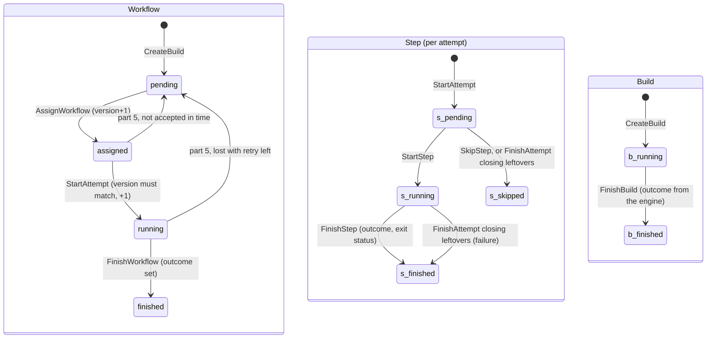

## Goal Capsule

- **Objective:** an accepted workflow runs as a numbered attempt whose steps move through their states, and the workflow and its build finish with an outcome.
- **Parent:** #20, part 5 of 5. Read it only for a question this part does not answer.
- **Open blockers:** none.

## Builds on

Already on main when this part starts; read the code, not these parts' files.

- Part 4 (U4): `CreateBuild`, `GetBuild`, `PendingWorkflows`, `AssignWorkflow`, and the sqlc setup (`sqlc.yaml`, `queries.sql`, the generated `queries/` package).

## Product Contract

### Summary

This part adds `StartAttempt`, `FinishAttempt`, `StartStep`, `FinishStep`, `SkipStep`, `FinishWorkflow` and `FinishBuild`.
With them a build goes through its whole lifecycle, and has an outcome only once finished.

### Context

It completes the lifecycle every later part of #4 writes to, and the store #20 asks for.
Text copied from #20 says "part 1" to "part 7" for the parts of #4, of which #20 is part 2. This split's parts are "part k of this split" here and "Part k" under Builds on.

### Key Decisions

- **A workflow's state is separate from its outcome, and there are few states.** A state exists only where the engine treats the workflow differently. Why it waits (a runner, later a slot) is an attribute of the `crew.wait` span, not a state. Slice 2 adds `waiting` for dependencies. Governs R11. (session-settled: user-approved — chosen over one state per wait reason and over one status that mixes state and outcome.)

### Requirements

**Lifecycle**

- R11. A workflow moves `pending → assigned → running → finished`, and has an outcome (success or failure) only once finished. A step moves `pending → running → finished`, or ends `skipped`. A build moves `running → finished` with its workflow's outcome.

### Key Flows

- F1. Run a file by hand
  - **Trigger:** a person, inside a git repository, runs `crew-actions run test.yaml` with an engine and a runner up.
  - **Steps:** `run` parses the identity and sends the file. The engine checks it and creates the build with its workflow `pending`. The runner asks for work, accepts it, and runs the steps in a new directory, sending states and output. `run` prints them as they come. The runner reports `done`.
  - **Outcome:** `run` exits 0 or 1 with the build's outcome, and the build, workflow, attempt and steps are rows, with their logs on disk.
  - **Covered by:** R1, R2, R3, R6, R9, R11, R12, R18, R21 (this part supplies the rows and the identity parsing that R10 and R11 ask for. The rest is in other parts.)

### Scope Boundaries

- Attempts that fail for a lost runner and go back to `pending` (R14) belong to part 5. So does R26, which sets how the store's tests run against a real Postgres, since it also names the lost-runner end-to-end test.
- The `waiting` state for dependencies stays with slice 2.
- Considered and not built:
  - Idempotent repeats of a transition (R17's retries). They belong to part 5, which owns R17. Every repeat is a conflict here (KTD7).
  - Lease columns, a lost reason on attempts, and trace or span ids on rows. Parts 5 and 6 each add the columns they need in their own migration (KTD9).
  - `pg_notify` on writes, for `next`'s long poll and `run`'s live follow. This belongs to part 4, inside its own transactions.

#### Deferred to Follow-Up Work

- A CI check that sqlc's generated code matches the queries. This part commits the generated code and records how to regenerate it (KTD10).

### Sources / Research

Split from #20.

- Issue #20, split from #4 (its lifecycle diagram, R13 to R17 and the Deferred to Planning questions show what the later parts expect from these rows).
- `docs/architecture.md`: section 4 (package layout and import rules), section 8 ("an open span is not exported", so spans read their start from rows), and D4, D6.
- `docs/exploration/crew-actions.md`: "Next: a build's lifecycle".
- `.github/workflows/ci.yml` and `.testcoverage.yml`: `go test -race -coverpkg=./...` on Linux and macOS, and a 90% total coverage floor checked on Linux only.

---

## Planning Contract

### Key Technical Decisions

- KTD1. **One `postgres.Store` exposes small lifecycle primitives, and a transaction travels in the `context.Context`.** `Store.InTx(ctx, fn)` begins a transaction and passes `fn` a context that carries it. Every primitive joins the context's transaction when there is one, and otherwise runs in its own, so each primitive is atomic alone. No signature uses a pgx type. Primitives return `internal/model` types, and the conflict and not-found sentinels live in `internal/model`. So part 4's engine can declare its store interfaces with plain signatures, own the transactions (architecture section 4), and branch on errors without importing `store/postgres`. Rejected: an `InTx` callback that receives a store-specific `*Tx`, which would put a store type into every interface the engine declares.
- KTD5. **`workflows.version` goes up on every state change, and accepting compares it.** Hand-out returns the version, and starting an attempt succeeds only with that version while the workflow is `assigned`. This is D6's version column. It also fences a late accept after part 5 sends an unaccepted workflow back to `pending`. `assigned_at` records the hand-out for part 5's accept timeout (R13).
- KTD6. **Every call after accept names its attempt, and a workflow has at most one open attempt.** Step and finish primitives take the attempt id and refuse an attempt that has already ended. A partial unique index on `attempts(workflow_id) WHERE finished_at IS NULL` holds the "one open attempt" rule in the database. This way a runner part 5 has given up on cannot finish the attempt that replaced its own.
- KTD7. **Transitions are strict compare-and-set updates.** Each primitive moves a row from one named state to the next (`UPDATE … WHERE state = <from>`). A row in any other state gives the model's conflict sentinel, and a missing row gives not-found. Repeats are conflicts too (see Scope Boundaries).
- KTD8. **Ending an attempt closes its leftover steps, and the engine supplies the build's outcome.** Finishing an attempt with failure moves its `pending` steps to `skipped` and its `running` steps to `finished` with failure, in the same transaction. Finishing it with success is refused while any step is neither `finished` with success nor `skipped`. Finishing a build first locks its row, and refuses while any of its workflows is unfinished. The engine passes the outcome: the workflow's outcome in slice 0 (R11), and whatever rule slice 2 sets once a build has several workflows.
- KTD10. **sqlc generates the ordinary queries into `internal/store/postgres/queries`, for pgx v5, and the generated code is committed.** sqlc runs from its release binary, not the `tool` directive (architecture section 6), and `sqlc.yaml` records the version used and the command. Only the queries the primitives use are written, so no untested generated code counts against the coverage floor. The hand-out query (`FOR UPDATE SKIP LOCKED`) is an ordinary query. The claim loop around it is part 4's, written by hand (D9).

### High-Level Technical Design

**Lifecycles (R11, KTD4, KTD8).**

**Store surface (KTD1).** Each primitive is atomic alone, and composes with others under `InTx`. A row in an unexpected state gives the conflict sentinel (KTD7).

| Primitive | Effect |
|---|---|
| `StartAttempt` | `assigned → running` at the handed-out version. Opens attempt N+1 with `pending` steps named by the caller. |
| `StartStep`, `FinishStep`, `SkipStep` | Step transitions within an open attempt. |
| `FinishAttempt` | Ends an open attempt with an outcome and closes its leftover steps (KTD8). |
| `FinishWorkflow` | `running → finished` with an outcome. |
| `FinishBuild` | `running → finished` with the engine's outcome, refused while any workflow is unfinished. |

### Sequencing

U5 is the only unit. It needs part 4's primitives and sqlc setup.

---

## Implementation Units

### U5. Attempts, steps, and finishing workflows and builds

**Goal:** an accepted workflow runs as a numbered attempt whose steps move through their states, and the workflow and its build finish with an outcome.

**Requirements:** R11; KTD1, KTD5 to KTD8.

**Dependencies:** U4.

**Files:**
- Modify `internal/store/postgres/queries.sql` and regenerate `internal/store/postgres/queries/`.
- Create `internal/store/postgres/attempts.go` (`StartAttempt`, `FinishAttempt`), `internal/store/postgres/steps.go` (`StartStep`, `FinishStep`, `SkipStep`), and add `FinishWorkflow` to `internal/store/postgres/workflows.go` and `FinishBuild` to `internal/store/postgres/builds.go`.
- Create `internal/store/postgres/attempts_test.go` and `internal/store/postgres/steps_test.go`, and extend `internal/store/postgres/builds_test.go`.

**Approach:**
- `StartAttempt` takes the workflow id, the handed-out version and the step names in order. It moves the workflow `assigned → running`, inserts the next attempt number with `accepted_version`, and inserts the steps `pending` at positions 1 to N.
- Step primitives take the attempt id and position, and require the attempt to be open (KTD6).
- `FinishStep` records the outcome and an optional exit status.
- `FinishAttempt` follows KTD8. `FinishWorkflow` requires the workflow to be `running` with no open attempt, so the engine composes `FinishAttempt` then `FinishWorkflow` under `InTx`.
- `FinishBuild` locks the build row first (KTD8).
- Timestamps come from the database's `now()`.

**Test scenarios:**
- Happy path, composed as part 4 will compose it: create, assign, start an attempt with three steps, start and finish each step with success, then `FinishAttempt`, `FinishWorkflow` and `FinishBuild`, each with success, in one `InTx`. `GetBuild` shows the build and workflow `finished` with success, attempt 1 closed, and every step `finished` with its timestamps set.
- Three steps where the second fails: the first `finished` with success, the second `finished` with failure and exit status 1, the third skipped by `SkipStep`. The attempt, workflow and build finish with failure.
- `FinishAttempt` with failure while one step is `running` and one is `pending` leaves the first `finished` with failure and no exit status, and the second `skipped`.
- `FinishAttempt` with success while a step is still `pending` gives the conflict sentinel and changes nothing.
- `StartAttempt` with a stale version, or on a `pending` workflow, gives the conflict sentinel. With the right version it opens attempt number 1 and bumps the version.
- A step call against an attempt that has finished gives the conflict sentinel.
- `StartStep` on a running step, `SkipStep` on a running step, and `FinishStep` on a pending step each give the conflict sentinel.
- `FinishWorkflow` on an `assigned` workflow, or while its attempt is still open, gives the conflict sentinel.
- `FinishBuild` while a workflow is unfinished gives the conflict sentinel, and the build stays `running` with no outcome.
- An error returned inside `InTx` after `FinishAttempt` leaves the attempt open and the workflow `running`.

**Verification:** the tests above pass, and the total coverage of `go test -coverpkg=./...` on Linux stays at or above 90%.

---

## Verification Contract

| Gate | Command or check | Applies to |
|---|---|---|
| Format and vet | `gofmt -l cmd internal` prints nothing, and `go vet ./...` passes | all |
| Lint | golangci-lint v2.14.0 (`go run github.com/golangci/golangci-lint/v2/cmd/golangci-lint@v2.14.0 run`) passes with `.golangci.yml` as it is | all |
| Tests | `go test -race -covermode=atomic -coverpkg=./... -coverprofile=coverage.out ./...` passes with Docker running, and the store's tests skip cleanly without Docker | all |
| Coverage floor | the total in `coverage.out` is at least 90% (`.testcoverage.yml`) | all |
| Generated code | running the sqlc command recorded in `internal/store/postgres/sqlc.yaml` leaves `internal/store/postgres/queries/` unchanged | U5 |

---

## Definition of Done

- U1 to U5 are done when their test scenarios pass and their Verification lines hold.
- Every gate in the Verification Contract passes, locally with Docker and in CI's Linux and macOS jobs.
- `internal/model` imports nothing that does I/O. pgx, goose and the generated queries are imported only under `internal/store/postgres`.
- No command, protocol call, lease column or telemetry code was added.

<!-- cw-split-ce-plan: part of #20 -->

<!-- publish-split: part 5 of #20 -->

