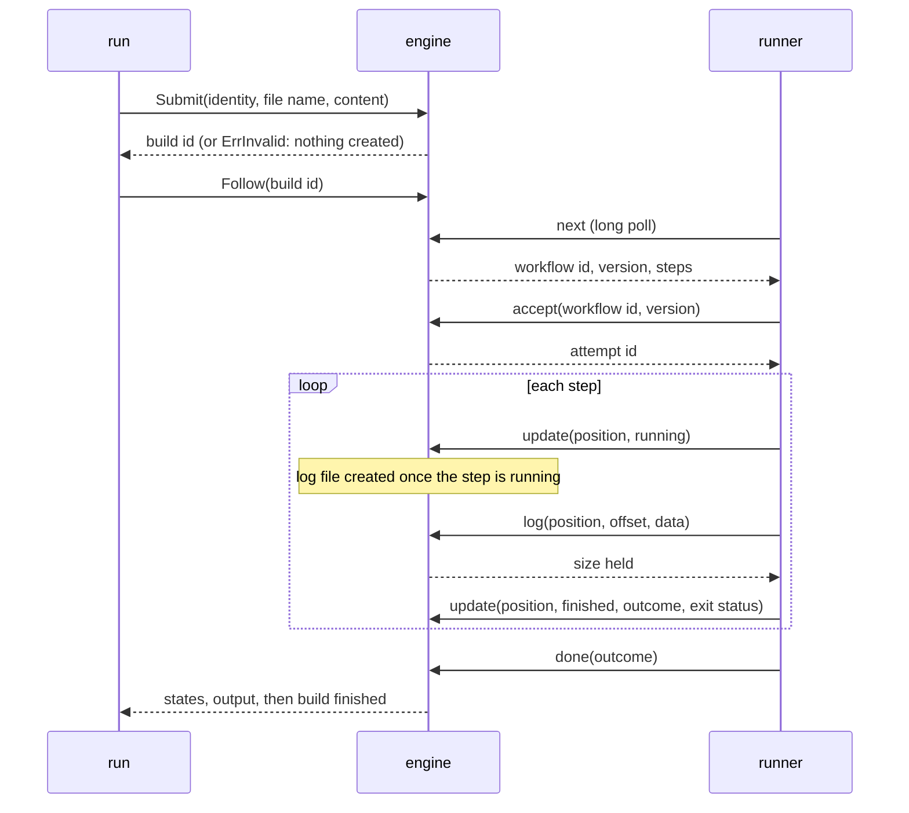

## Goal Capsule

- **Objective:** the runner protocol and the client API exist as protobuf services with the Go interfaces the engine implements, generated with buf and committed.
- **Parent:** #22, part 5 of 11. Read it only for a question this part does not answer.
- **Open blockers:** none.

## Builds on

Already on main when this part starts; read the code, not these parts' files.

- Part 2 (U2): `model.ErrInvalid`, which an `UNSPECIFIED` or unknown enum converts to.

## Product Contract

### Summary

`RunnerService` (`next`, `accept`, `update`, `log`, `done`) and `BuildService` (`Submit`, a streaming `Follow`), their generated messages and connect code, the enum conversions to `internal/model`, and the `protocol.Engine` and `api.Builds` interfaces.

### Context

Every later part speaks these contracts: the engine implements them, the transport serves them, and the runner and the follower call them. This part builds some of R1, R2 and R3, which part 11 completes. In text copied from #22, "part 5", "part 6" and "part 7" are parts of #4, not of this split.

### Key Decisions

- **The engine and the runner run as separate processes, over `transport/connect`.** Revises the architecture's slice 0 (engine and runner in one process over `transport/inproc`) and slice 9 (which brought `transport/connect`); slice 9 keeps remote machines and runner authentication, and `transport/inproc` stays for the end-to-end tests. Governs R1, R2. (session-settled: user-directed — chosen over one process with the kill demonstrated only by a test, and over one process that drains the queue on restart: the demonstration needs the runner killed alone while the engine lives.)
- **The engine is long-lived and `run` is a client of a minimal client API.** Revises slice 10, which keeps the rest of the API (listing, cancelling, the TUI). Governs R1, R3, R4. (session-settled: user-approved — chosen over an engine that takes the file at start: that shape is thrown away once events and the API arrive, while a manual start is already an event a client sends.)
- **The engine listens on loopback only until runners authenticate.** The API and the protocol have no authentication yet, so any other address would let anyone on the network run commands on the machine. Governs R1. (session-settled: user-approved — chosen over listening on any address in slice 0.)
- **Step output is kept on the engine's disk, one log per step and attempt, and `run` shows it live.** Governs R3, R21. (session-settled: user-approved — chosen over `run` showing only states and the outcome.)

### Scope Boundaries

- No implementation of either interface: the engine is parts 6 and 7's, the handlers and clients part 8's.
- Cancelling a build, listing builds and the rest of the client API stay with slice 10.

Considered and not built:

- **The `register` call.** It declares a runner's name, labels and capacity, which slice 4 brings.

#### Deferred to Follow-Up Work

- A CI check that `buf generate` and sqlc leave the generated code unchanged, as #20's plan already defers for sqlc.
- The `traceparent` of architecture section 5: part 6, as a header that a `transport/connect` interceptor handles through `internal/telemetry`, plus a parent in `next`'s answer.

### Sources / Research

Split from #22.

- `docs/architecture.md`: sections 3–5.
- connect-go v2 (`connectrpc.com/connect/v2`, v2.0.0): HTTP lives in `connecthttp`; handlers and clients take plain messages with no request wrapper; `connect.NewError` takes a message string; server streaming works over HTTP/1.1; `WriteTimeout` and `http.Client.Timeout` break streams and long polls; `Shutdown` does not cancel handlers; a server killed mid-stream reaches the client as a non-remote error, not `Unavailable`.

## Planning Contract

### Key Technical Decisions

- KTD1. **Packages follow the architecture's section 4, and `transport/connect` serves both services.** `internal/protocol` holds the runner protocol's messages and its one Go interface. `internal/api` holds the client API's messages, its Go interface and the client-side follower. `internal/engine` exposes two small types over one core, one implementing each interface, so the two services' method names never collide, and declares the store and log interfaces it uses. `internal/transport/connect` adapts both services to HTTP, as server handlers and as clients. `internal/store/logs` keeps logs on disk. `internal/runner` loops on the protocol. `cmd/crew-actions` reads flags and the environment, wires the pieces and prints. The connect-go rule holds unchanged, since its `connectrpc.com/connect` prefix already covers `connectrpc.com/connect/v2` and its subpackages. Rejected: plain HTTP with JSON in `internal/api`, which would give one engine two transports and two error vocabularies.
- KTD2. **The protocol has five calls in this part: `next`, `accept`, `update`, `log` and `done`.**
  - `next` returns a workflow's id, the version `AssignWorkflow` returned, its name and its resolved steps (names and commands), or nothing.
  - `accept` takes the workflow id and that version and returns the attempt id.
  - `update` takes the attempt id, a 1-based step position, the state (`running`, `finished` or `skipped`), the outcome, and an exit status or none.
  - `log` takes the attempt id, the position, a byte offset and at most 64 KiB of data, and returns the size the engine now holds (KTD7).
  - `done` takes the attempt id and the outcome.

  The runner maps the executor's 0-based index to the 1-based position, and its exit status -1 to none, in one adapter. The engine refuses a position outside the attempt's steps.
- KTD3. **The stored definition is the compiled workflow, encoded as the protocol's `Workflow` message.** The engine runs `spec.Parse` once, at submit, which is where R8's refusal happens. It stores the name and resolved steps that `next` hands out and `accept` takes the step names from, as `model.Workflow.Definition`'s comment and the first migration already describe. Rejected: storing the file and parsing it again at hand-out, where a file a newer parser refuses would roll back the hand-out and stall the queue behind the oldest pending workflow.
- KTD9. **`Follow` diffs snapshots and log sizes, in an order that never shows a state before its output.** Each pass reads `GetBuild` first, as one consistent snapshot (`REPEATABLE READ`, read only), and the log sizes second. A step with no log file yet counts as 0 bytes. Because the runner drains a step's log before its `finished` update and the engine writes before it answers, every byte a snapshot's states imply is on disk by then. Per workflow, a pass sends:
  1. a workflow state change that is not `finished`;
  2. per attempt and step, a `running` it missed between passes, then any new output, then the terminal state;
  3. the workflow's `finished`;
  4. after every workflow, the build's end.

  Every stream starts from the beginning, and every event carries the attempt number, the position and, for output, its byte offset. The client drops what it already printed, keyed by attempt and position, so part 5's second attempt is never taken for a repeat. Rejected: a resume cursor on the server, which the client would have to dedupe against anyway.
- KTD15. **The protos live in `proto/`, generated with buf, and the generated code is committed.** `protoc-gen-go` and `protoc-gen-connect-go` (v2) go through `go.mod`'s `tool` directive, and buf is installed at a pinned version (architecture section 6). Messages are generated under `internal/protocol` and `internal/api`. `buf.gen.yaml` pins the connect plugin's output under `internal/transport/connect`, so connect code never lands beside the messages, and records the buf version and the command, as `sqlc.yaml` does. `.testcoverage.yml` excludes the generated paths from the coverage floor. Packages are `crewactions.protocol.v1` and `crewactions.api.v1`, to pass buf's STANDARD lint. No method is marked `NO_SIDE_EFFECTS`, so connect answers no GET.

### High-Level Technical Design

F1 over the two services (KTD2, KTD5, KTD7, KTD8, KTD9):



### Output Structure

```text
proto/crewactions/protocol/v1/protocol.proto
proto/crewactions/api/v1/api.proto
buf.yaml, buf.gen.yaml
internal/protocol/            protocol.go + generated messages
internal/api/                 api.go + generated messages
internal/transport/connect/   generated connect code
```

The `.gitkeep` files in `internal/api`, `internal/protocol` and `internal/transport/connect` go once those folders hold code.

### Risks & Dependencies

- **connect-go v2 is new.** v2.0.0 was tagged on 2026-10-07, and its API differs from v1's: no request wrappers, and HTTP lives in `connecthttp`. Examples written for v1 do not apply. Dependabot moves it (D15).
- **New modules face `dependency-review`.** connect-go v2 and protobuf-go are Apache-2.0 and BSD-3-Clause, and both plugins arrive through the `tool` directive. If `security.yml`'s license check rejects one, the unit stops and reports it rather than swapping the choice, which D12 fixes.
- **buf is not installed** on this machine or in CI. The implementer installs the pinned version to generate, and CI does not run it (Deferred to Follow-Up Work).
- **Generated code would sink the coverage floor.** KTD15's exclusion keeps the floor about hand-written code.

### Sequencing

One unit, U5.

## Implementation Units

### U5. Protocol and API contracts

**Goal:** the runner protocol and the client API exist as protobuf services with Go interfaces the engine implements, generated and committed.

**Requirements:** R1, R2, R3; KTD1, KTD2, KTD9, KTD15.

**Dependencies:** none.

**Files:**
- Create `proto/crewactions/protocol/v1/protocol.proto`, `proto/crewactions/api/v1/api.proto`, `buf.yaml` and `buf.gen.yaml`.
- Create the generated message packages under `internal/protocol/` and `internal/api/`, and the generated connect packages under `internal/transport/connect/`.
- Create `internal/protocol/protocol.go`, `internal/protocol/protocol_test.go`, `internal/api/api.go` and `internal/api/api_test.go`.
- Modify `go.mod` and `go.sum` (connect-go v2, protobuf-go and the two plugins as tools) and `.testcoverage.yml`.
- Delete the `.gitkeep` files of `internal/protocol`, `internal/api` and `internal/transport/connect`.

**Approach:**
- `RunnerService` carries the five calls of KTD2.
- `BuildService` carries `Submit` (host, organization, repository, file name, content → build id) and a server-streaming `Follow` (build id → events). The events are: workflow state; step state with attempt number, position, name, outcome and exit status; output with attempt number, position, offset and data; and the build's end with its outcome.
- The `Workflow` message (name and resolved steps) is both `next`'s payload and the stored definition (KTD3).
- States and outcomes are proto enums. Their conversions to `internal/model`'s types live once, in `internal/protocol` and `internal/api`, and an `UNSPECIFIED` value is `ErrInvalid`.
- `protocol.Engine` and `api.Builds` are the Go interfaces. `Follow` takes a send function rather than a connect stream type.
- `.testcoverage.yml` excludes the generated paths.

**Patterns to follow:** `internal/store/postgres/sqlc.yaml`'s header comment for recording a generator's version and command.

**Test scenarios:**
- Each enum converts to its `model` value and back. `UNSPECIFIED` and an unknown number give `ErrInvalid`.

**Verification:** `buf lint` passes, `buf generate` leaves the tree unchanged, `go mod tidy` leaves `go.mod` unchanged, and `go build ./...` passes.

## Verification Contract

| Gate | Command or check | Applies to |
|---|---|---|
| Format and vet | `gofmt -l cmd internal` prints nothing, and `go vet ./...` passes | all |
| Lint | `go run github.com/golangci/golangci-lint/v2/cmd/golangci-lint@v2.14.0 run` passes, with `.golangci.yml` changed only by KTD16's narrowed entry | all |
| Tests | with `docker compose up --detach --wait test-postgres` and `CREW_ACTIONS_TEST_DATABASE_URL` set as `AGENTS.md` says, `go test -race -covermode=atomic -coverpkg=./... -coverprofile=coverage.out ./...` passes; without the variable, the database tests skip | all |
| Coverage floor | the total in `coverage.out`, with the generated paths excluded, is at least 90% (`.testcoverage.yml`) | all |
| Tidy | `go mod tidy` leaves `go.mod` and `go.sum` unchanged | U5 |
| Generated code | `buf lint` passes, and `buf generate` leaves the tree unchanged | U5 |

## Definition of Done

- U5 is done when its test scenarios pass and its Verification lines hold.
- Every gate in the Verification Contract passes, locally and in CI's Linux and macOS jobs.
- depguard passes with only KTD16's narrowed entry changed: connect-go only in `internal/transport/connect`, pgx and goose only in `internal/store/postgres`, and the runner free of `engine`, `scheduler` and `store`.
- No lease, retry, `register` call, `transport/inproc` or telemetry code was added (parts 5 and 6, slice 4).
- No code from abandoned approaches is left in the diff.

<!-- cw-split-ce-plan: part of #22 -->

<!-- publish-split: part 5 of #22 -->

