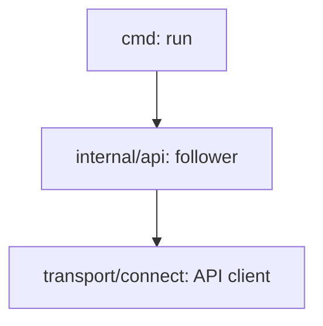

## Goal Capsule

- **Objective:** a client follows a build across engine restarts and sees each state and byte of output once.
- **Parent:** #22, part 10 of 11. Read it only for a question this part does not answer.
- **Open blockers:** none.

## Builds on

Already on main when this part starts; read the code, not these parts' files.

- Part 5 (U5): the client API's messages and the `api.Builds` interface the follower calls. Part 2's sentinels come with it.

## Product Contract

### Summary

The client-side follower in `internal/api`: it calls `Follow`, reconnects every second on `ErrUnavailable`, drops what it already delivered, keyed by attempt and position, and returns the build's outcome.

### Context

This is what lets `run` survive an engine restart without printing anything twice. This part builds some of R3 and R4, which part 11 completes. In text copied from #22, "part 5", "part 6" and "part 7" are parts of #4, not of this split.

### Key Decisions

- **The engine is long-lived and `run` is a client of a minimal client API.** Revises slice 10, which keeps the rest of the API (listing, cancelling, the TUI). Governs R1, R3, R4. (session-settled: user-approved — chosen over an engine that takes the file at start: that shape is thrown away once events and the API arrive, while a manual start is already an event a client sends.)
- **Step output is kept on the engine's disk, one log per step and attempt, and `run` shows it live.** Governs R3, R21. (session-settled: user-approved — chosen over `run` showing only states and the outcome.)

### Scope Boundaries

- Tested against a fake `api.Builds`; rendering the events and `run`'s exit codes are part 11's.

### Sources / Research

Split from #22.

- `docs/architecture.md`: sections 3–5.

## Planning Contract

### Key Technical Decisions

- KTD9. **`Follow` diffs snapshots and log sizes, in an order that never shows a state before its output.** Each pass reads `GetBuild` first, as one consistent snapshot (`REPEATABLE READ`, read only), and the log sizes second. A step with no log file yet counts as 0 bytes. Because the runner drains a step's log before its `finished` update and the engine writes before it answers, every byte a snapshot's states imply is on disk by then. Per workflow, a pass sends:
  1. a workflow state change that is not `finished`;
  2. per attempt and step, a `running` it missed between passes, then any new output, then the terminal state;
  3. the workflow's `finished`;
  4. after every workflow, the build's end.

  Every stream starts from the beginning, and every event carries the attempt number, the position and, for output, its byte offset. The client drops what it already printed, keyed by attempt and position, so part 5's second attempt is never taken for a repeat. Rejected: a resume cursor on the server, which the client would have to dedupe against anyway.
- KTD10. **`run` parses the identity itself, never retries the submit and reconnects only on `ErrUnavailable`.** Only host, organization and repository leave the client, never the URL (R9). The submit runs once on its own 30-second context, so a Ctrl-C during it still learns the build id. `run` prints the build id as soon as it has it. On `ErrUnavailable` the follower says so once and reconnects every second. On `ErrNotFound` it exits 1. A Ctrl-C prints that the build continues and exits 130.

### High-Level Technical Design

Who calls whom, cut to the follower. Arrows point from caller to callee:



### Output Structure

```text
internal/api/                 follow.go
```

### Sequencing

One unit, U10.

## Implementation Units

### U10. The follower

**Goal:** a client follows a build across engine restarts and sees each state and byte of output once.

**Requirements:** R3, R4; KTD9, KTD10.

**Dependencies:** U2, U5.

**Files:**
- Create `internal/api/follow.go` and `internal/api/follow_test.go`.

**Approach:**
- It calls `Follow` and hands each new event to a callback.
- It remembers the states seen and the bytes received per attempt and position, and on a reconnect trims an output event to the bytes past what it received.
- It reconnects every second on `ErrUnavailable`, calling a notice hook once per outage.
- It returns the build's outcome at the build's end, and returns on `ErrNotFound` and when its context ends.

**Test scenarios:** against a fake `api.Builds` that scripts streams:
- A stream that ends with `ErrUnavailable` after part of a step's output, then a full replay: the callback sees every byte and every state exactly once.
- A replay where attempt 2 repeats attempt 1's positions: attempt 2's states and output are all delivered.
- `ErrNotFound` on reconnect returns `ErrNotFound`.
- A cancelled context during the backoff returns the context's error.

**Verification:** the scenarios pass under the race detector.

## Verification Contract

| Gate | Command or check | Applies to |
|---|---|---|
| Format and vet | `gofmt -l cmd internal` prints nothing, and `go vet ./...` passes | all |
| Lint | `go run github.com/golangci/golangci-lint/v2/cmd/golangci-lint@v2.14.0 run` passes, with `.golangci.yml` changed only by KTD16's narrowed entry | all |
| Tests | with `docker compose up --detach --wait test-postgres` and `CREW_ACTIONS_TEST_DATABASE_URL` set as `AGENTS.md` says, `go test -race -covermode=atomic -coverpkg=./... -coverprofile=coverage.out ./...` passes; without the variable, the database tests skip | all |
| Coverage floor | the total in `coverage.out`, with the generated paths excluded, is at least 90% (`.testcoverage.yml`) | all |

## Definition of Done

- U10 is done when its test scenarios pass and its Verification lines hold.
- Every gate in the Verification Contract passes, locally and in CI's Linux and macOS jobs.
- depguard passes with only KTD16's narrowed entry changed: connect-go only in `internal/transport/connect`, pgx and goose only in `internal/store/postgres`, and the runner free of `engine`, `scheduler` and `store`.
- No lease, retry, `register` call, `transport/inproc` or telemetry code was added (parts 5 and 6, slice 4).
- No code from abandoned approaches is left in the diff.

<!-- cw-split-ce-plan: part of #22 -->

<!-- publish-split: part 10 of #22 -->

